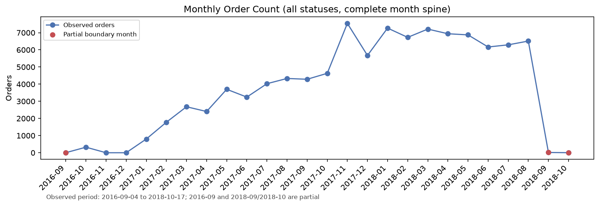
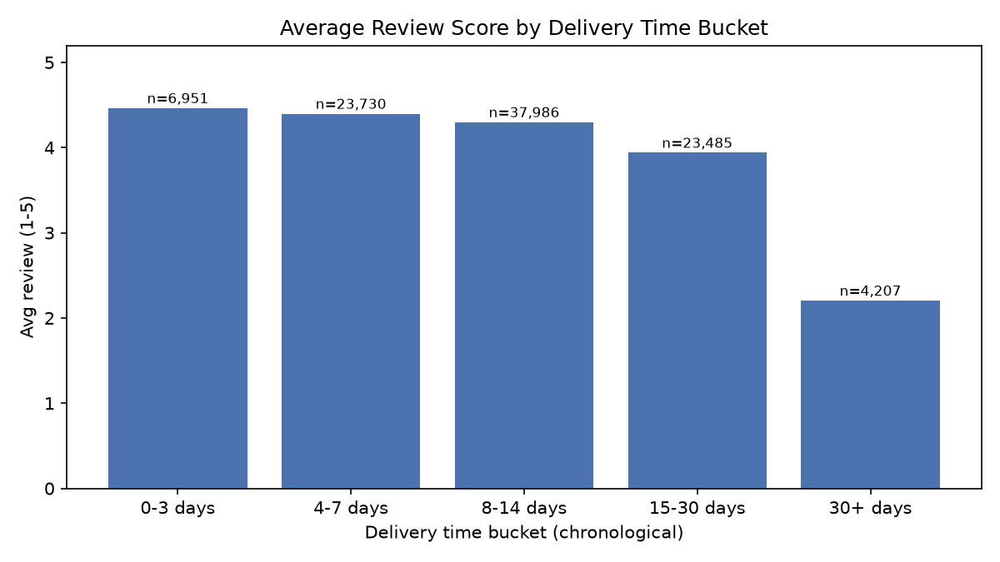
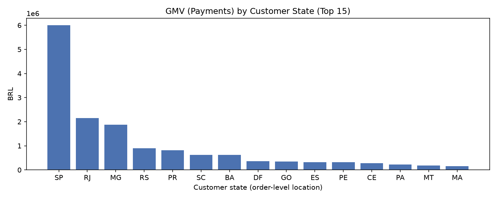

# Olist Consumer Intelligence & Market Intelligence Assessment

Evidence-based consumer and marketplace intelligence analysis of the **Brazilian E-Commerce Public Dataset by Olist** (observed **2016-09-04 to 2018-10-17**, ~100k orders). Built as a reproducible portfolio project for market intelligence: clear business questions, approved KPI governance, validated pipeline, and decision-oriented recommendations.

**Source:** [Olist Brazilian E-Commerce Dataset (Kaggle)](https://www.kaggle.com/datasets/olistbr/brazilian-ecommerce) | **Project:** OLIST-CI-02 | **Primary audience:** E-commerce marketplace management

---

## Business Problem

Marketplace teams need an integrated view of purchasing behavior, customer experience, category performance, and geographic operations. Transaction, item, payment, delivery, review, and customer data live in separate tables and must be reconciled at the correct grain before they can support reliable decisions.

**Research questions**
1. What patterns characterize consumer purchasing behavior?
2. How are delivery performance and freight costs associated with customer review scores?
3. How do purchasing patterns and review scores differ across product categories?
4. How do purchasing patterns and delivery performance vary by geographic region?

## Key Findings (approved KPIs)

*Metrics follow `docs/olist/03_kpi_definitions.md` v1.1 (source, `order_status` filter, and grain stated). `gmv_payments` is payment-based order value (sum of payments). Observational 2016–2018 data; associations, not causation.*

| Domain | Finding | Evidence (grain/filter) |
|---|---|---|
| Purchase behavior | **99,441 orders**, **~16.01M BRL GMV (payments)**, **AOV ~160.99 BRL** (median ~105.29), avg **1.13 items/order** | `analytics.fact_orders`, all `order_status` |
| Retention & risk | **Repeat rate ~3.12%** (2,997/96,096 `customer_unique_id`); **cancellation rate ~0.63%** (625/99,441) | `staging.orders`+`staging.customers` linkage / `fact_orders`, all statuses |
| Delivery & experience | **On-time rate ~93.23%** (89,941/96,476 delivered with estimate); **avg delivery ~12.50 days** (n=96,478); **avg review ~4.086** (n=99,224 review-order records, valid 1–5) | `fact_delivery` + `analytics.fact_reviews` (grain `review_id,order_id`), delivered/valid constraints |
| Experience gap | On-time/early avg review **~4.290** (n=89,949) vs late **~2.271** (n=6,410). Buckets (chronological): 0–3d **~4.464** (n=6,951), 4–7d **~4.397** (n=23,730), 8–14d **~4.298** (n=37,986), 15–30d **~3.940** (n=23,485), 30+d **~2.204** (n=4,207). Pearson/Spearman (delivery days, review): **~-0.334 / ~-0.235** | Review-order joined to delivery; associations only |
| Category mix | Revenue concentrated in `beleza_saude`, `relogios_presentes`, `cama_mesa_banho`, `esporte_lazer`, `informatica_acessorios` with varying avg reviews | `fact_order_items` (item grain) + avg order-level review among orders containing the category (distinct `order_id,category`) |
| Geography | GMV/orders concentrated in **SP/RJ/MG/RS/PR** (SP: 41,746 orders, ~5.998M BRL). Avg delivery lower in **SP (~8.3d)** vs several North/Northeast states **~19–24+d**. Mapping reconciles to **99,441 orders / ~16.01M BRL** | `fact_orders` joined `staging.customers.customer_id` (order-level location), delivered orders for delivery avg |

*Monthly trend chart uses a complete month spine and marks partial boundary months (2016-09, 2018-09, 2018-10) and missing 2016-11; do not interpret endpoints as trend breaks.*

## Recommendations (prioritized)

1. **Protect delivery reliability (High, Ops/CX/Seller mgmt):** Reduce late deliveries and monitor on-time/lead-time buckets by lane/seller; late delivery aligns with materially lower reviews (association).
2. **Close regional SLA gaps (High, Ops/Marketplace):** Benchmark long-haul states/routes and target carrier/mode improvements while sustaining high-volume corridors.
3. **Category scorecards (Medium, Category/Commercial/CX):** Track GMV, orders, delivery, and review together (order-category review interpretation); prioritize high-revenue, lower-review segments.
4. **Validate retention signal (Medium, Marketplace/CRM):** Low observed repeat (~3.12%) depends on `customer_unique_id` linkage and observed period; confirm identity before loyalty conclusions.
5. **Monitor cancellations explicitly (Medium, Ops):** Keep `canceled` distinct from `unavailable` in operational reporting (approved definition).

Details: [Executive summary](docs/executive_summary.md) · [Strategic recommendations](docs/strategic_recommendations.md)

## Visual Highlights

| Monthly order volume | Avg review by delivery time bucket | GMV by customer state (Top 15) |
|---|---|---|
|  |  |  |

---

## Repository Guide

```text
olist-consumer-intelligence/
├── data/raw/                 # Source CSVs (gitignored)
├── db/                       # DuckDB warehouse (gitignored)
├── docs/                     # Charter, research design, KPI dict, data dictionary, architecture, DoD, reports, assets
├── notebooks/                # 00–05 analysis notebooks (grain-aligned)
├── outputs/                  # Regenerable findings/charts/reports (gitignored by default)
├── queries/                  # SQL: 01_staging.sql, 02_analytics.sql
├── scripts/                  # Pipeline utilities and export
├── src/                      # ETL, validation, grain checks, config
├── tests/                    # Integrity/KPI tests
└── README.md
```

**Start here by audience:** [Portfolio audience guide](docs/portfolio_audience_guide.md) (30s / 5min / deep-dive paths).

## Reproducibility

**Prerequisites:** Python 3.11+, dependencies in `pyproject.toml` (`pip install -e .[dev]` or `pip install -r requirements-lock.txt` for a pinned environment snapshot), Kaggle Olist CSVs in `data/raw/` (see `src/config.py`). CI runs lint/format/type/test via `.github/workflows/ci.yml` (DB-dependent integrity tests skip when `db/` and `outputs/findings/` artifacts are not present).

```bash
# End-to-end pipeline (ingest -> validate -> transform -> grain-checks -> analytics-validate -> integrity -> export)
python -m src.pipeline run --overwrite

# If raw tables already exist and you want to keep them, run stages individually:
# python -m src.pipeline validate
# python -m src.pipeline transform
# python -m src.pipeline grain-checks
# python -m src.pipeline analytics-validate
# python -m src.pipeline integrity
# python -m src.pipeline export

# Quality checks
python -m pytest -q
python -m ruff check .
python -m black --check .
python -m mypy src --ignore-missing-imports
```

Notebooks in `notebooks/00–05` are executable top-to-bottom (set `PYTHONPATH` to project root when running outside an installed environment). Key artifacts: `docs/executive_summary.md`, `docs/strategic_recommendations.md`, `docs/assets/*.png`, and regenerable `outputs/findings/*`, `docs/olist/analytics_validation.json`, `docs/olist/integrity_check.json`.

## Data Quality & Analytical Rigor

- **Pipeline:** `raw -> staging -> analytics` in DuckDB; raw data immutable; idempotent SQL transforms; explicit ingest rerun behavior.
- **Validation:** Row/null/key/referential/range checks and grain/transform assertions (`outputs/findings/data_quality.json`, `docs/olist/analytics_validation.json`, `docs/olist/integrity_check.json`, `python -m src.pipeline grain-checks`).
- **Governance:** Approved KPI definitions and filters in `docs/olist/03_kpi_definitions.md`; every metric reported with source table, filter, and grain.
- **Known data notes:** Raw `reviews.review_id` has duplicate IDs linked to different orders (preserved as `review_id,order_id` pairs in analytics); `product_category_name` ~1.85% null; repeat behavior depends on `customer_unique_id` linkage and observed period. See `docs/olist/04_pitfalls.md`.

## Tech Stack

Python 3.11, DuckDB, SQL, pandas/NumPy, Matplotlib/Plotly/Seaborn, SciPy/statsmodels, Jupyter, pytest/ruff/black/mypy.

## Documentation

- [Project charter](docs/project_charter.md) · [Research design](docs/research_design.md) · [Data dictionary](docs/data_dictionary.md) · [System architecture](docs/system_architecture.md)
- [KPI definitions (approved)](docs/olist/03_kpi_definitions.md) · [Olist overview & schema](docs/olist/01_overview.md) · [Analysis pitfalls](docs/olist/04_pitfalls.md)
- [Definition of Done](docs/definition_of_done.md) · [Dataset license & attribution](docs/dataset_license_notes.md)

## Limitations & Ethics

- Observational marketplace sample (2016–2018); **not causal**, not representative of all Brazilian e-commerce or current conditions.
- `review_score` is a satisfaction proxy; response/coverage and timing biases possible. Review metrics are reported as review records/review-order pairs where applicable (see grain notes). Category/state averages mask heterogeneity; monthly endpoints are partially observed.
- Data is anonymized by the publisher; do not attempt re-identification. Verify current dataset terms on Kaggle before public redistribution or commercial use and provide required attribution.

## Attribution & Licensing

**Dataset listing license: VERIFIED ON KAGGLE (2026-11-14).** The Kaggle dataset listing for *Brazilian E-Commerce Public Dataset by Olist* displays **CC BY-NC-SA 4.0**. **Legal interpretation of the intended portfolio/job-application use: NOT INDEPENDENTLY RESOLVED** (not automatically commercial or non-commercial; context-specific).

> Dataset: Brazilian E-Commerce Public Dataset by Olist. Source: https://www.kaggle.com/datasets/olistbr/brazilian-ecommerce. The Kaggle dataset listing identifies the license as CC BY-NC-SA 4.0 (https://creativecommons.org/licenses/by-nc-sa/4.0/). This project uses a cleaned, transformed, and analyzed version of the source data. The original dataset is not redistributed in this repository. No endorsement by Olist is implied.

- **BY:** provide appropriate attribution, source link, license link, and indicate modifications. **NC:** use must not be primarily intended for commercial advantage or monetary compensation. **SA:** qualifying adapted material publicly shared must be distributed under the same or a compatible license.
- This repository does not intentionally redistribute original raw CSV files or the local DuckDB database. It publishes selected aggregate findings, charts, and documentation. The dataset license does not automatically apply to all original Python/SQL/configuration code, and derived outputs do not automatically constitute Adapted Material in all cases; application depends on the material and applicable rights.
- **Project source code:** no project-wide open-source license is currently granted (no `LICENSE` file). Public visibility on GitHub does not grant general reuse permission. Any future code license must be limited to material the owner can license and must respect upstream/third-party terms (MIT for original code is a possible option pending owner authorization).

Details and distinctions (original dataset, project source code, analytical findings/derived outputs, third-party dependencies/assets): [docs/dataset_license_notes.md](docs/dataset_license_notes.md).
