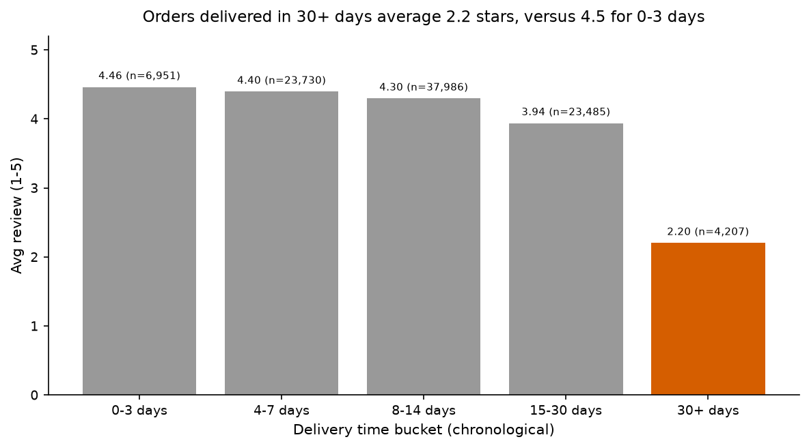
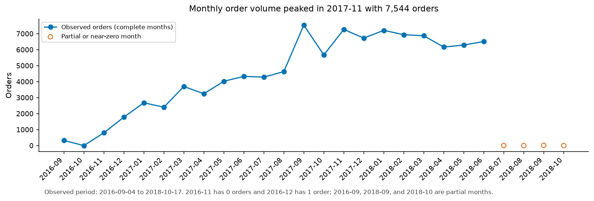
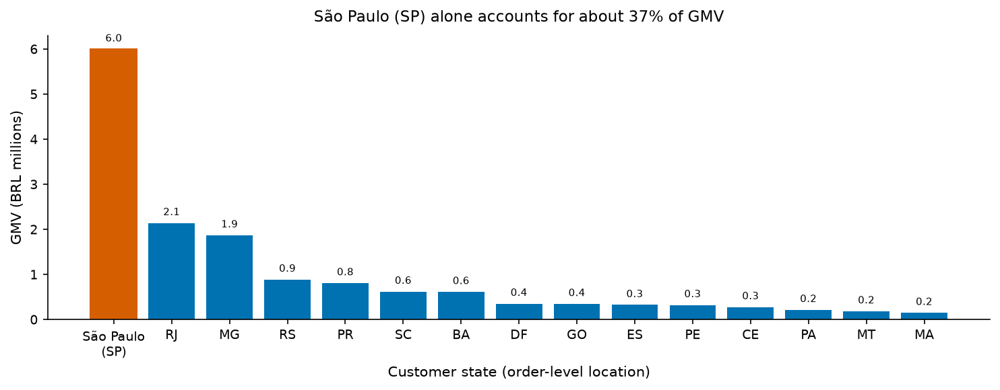

# Olist Consumer & Marketplace Intelligence

[](https://github.com/MaulanaKindi/olist-consumer-intelligence/actions)

This analysis covers roughly 100,000 orders from the Brazilian Olist e-commerce marketplace (observed 2016-09-04 to 2018-10-17) to answer one question: does delivery speed relate to customer satisfaction? This is an observational portfolio piece — it shows associations, not cause and effect.

## 30-second summary

The analysis joins orders, items, payments, deliveries, reviews, and customer location at the correct grain so each metric is counted once. The headline: orders delivered on time or early average about 4.3 stars, while late deliveries average about 2.3 stars — a clear gap. Delivery speed varies widely by state, and only about 3% of customers placed more than one order in the period. Together these suggest that delivery reliability is the most promising area to investigate or test; the data show associations, not causes.

## Headline numbers

- **99,441 orders** — total order volume in the observed period.
- **~16.01M BRL gross merchandise value (payments)** — total sales value across all orders.
- **160.99 BRL average order value** (median 105.29 BRL) — typical spend per order.
- **93.23% on-time delivery rate** — share of delivered orders arriving on or before the estimated date (derived late share: 6.77% = 100% minus the on-time rate).
- **Review gap: 4.29 stars on-time/early vs 2.27 late** — late delivery tracks with much lower satisfaction (association, not causation).
- **3.12% repeat customer rate** — share of customers placing more than one order.

Figure 1 — Average customer review score by delivery time bucket. Each bar is the average review (1–5 stars) for orders in that delivery window; `n` is the number of review-order records. The 30+ days bucket is highlighted because it has the lowest average review (computed from the data). How to read: taller review scores cluster in faster buckets; the gap widens sharply at 30+ days.



Note: this is a different cut from the headline review gap above. The headline compares on-time/early vs late orders relative to the estimated delivery date; Figure 1 groups orders by delivery duration in days.

## Glossary in plain English

- **GMV (gross merchandise value):** total sales value of orders, based on payments.
- **AOV (average order value):** GMV divided by number of orders.
- **Grain:** the level of detail a table uses — for example, one row per order, or one row per review linked to an order.
- **Review-order record:** one review linked to one order; an order can have more than one review record.
- **On-time rate:** share of delivered orders that arrived on or before the estimated delivery date.
- **Repeat rate:** share of customers who placed more than one order.

## What this demonstrates

- **Reconciled at the right grain:** orders, items, payments, deliveries, reviews, and customer location are joined so each order and each review-order pair is counted once, avoiding double counting.
- **Governed metrics:** every KPI follows a single approved dictionary (source table, `order_status` filter, and grain stated) in `docs/olist/03_kpi_definitions.md`.
- **Reproducible and tested:** a raw-to-staging-to-analytics DuckDB pipeline with validation and grain checks, plus lint, format, type, and test checks.

## Business problem

Marketplace teams need an integrated view of purchasing behavior, customer experience, category performance, and geographic operations. Transaction, item, payment, delivery, review, and customer data live in separate tables and must be reconciled at the correct grain before they can support reliable decisions.

**Research questions**
1. What patterns characterize consumer purchasing behavior?
2. How are delivery performance and freight costs associated with customer review scores?
3. How do purchasing patterns and review scores differ across product categories?
4. How do purchasing patterns and delivery performance vary by geographic region?

## Key findings

Compact summary; full source, filter, and grain detail for every metric is in `docs/olist/03_kpi_definitions.md` and `docs/executive_summary.md`.

| Finding | Number | Why it matters |
|---|---|---|
| Order volume and sales | 99,441 orders; ~16.01M BRL GMV | Scale of the marketplace in the observed window. |
| Typical spend | 160.99 BRL average order value (median 105.29 BRL) | Most orders are modest; the mean is pulled up by larger orders. |
| Delivery reliability | 93.23% on-time (derived late share 6.77%) | Most orders arrive on time, but a meaningful share is late. |
| Satisfaction gap | 4.29 stars on-time/early vs 2.27 late | Late delivery tracks with far lower reviews (association). |
| Delivery speed by state | 8.3 days in São Paulo (SP) vs 19–24+ days in several North/Northeast states | Service is uneven across regions. |
| Category revenue leaders | health_beauty, watches_gifts, bed_bath_table, sports_leisure, computers_accessories | Revenue concentrates in a handful of categories (English names; source slugs in the data dictionary). |
| Repeat behavior | 3.12% repeat customer rate | Limited observed repeat purchasing in-period. |

## Recommendations (prioritized)

1. **Protect delivery reliability (High):** Reduce late deliveries and monitor on-time and lead-time buckets by lane and seller. Late delivery aligns with materially lower reviews (association, not causation).
2. **Close regional SLA gaps (High):** Benchmark long-haul states and routes; target carrier and mode improvements while sustaining high-volume corridors such as São Paulo (SP).
3. **Category scorecards (Medium):** Track GMV, orders, delivery, and review together using order-category review interpretation; act on high-revenue, lower-review segments.
4. **Validate the retention signal (Medium):** The low observed repeat rate (3.12%) depends on customer identity linkage and the observed period; confirm linkage before loyalty conclusions.
5. **Monitor cancellations explicitly (Medium):** Keep `canceled` distinct from `unavailable` in operational reporting.

Details: [Executive summary](docs/executive_summary.md) · [Strategic recommendations](docs/strategic_recommendations.md) · [One-page summary](docs/one_page_summary.md)

## Visual highlights

| Monthly order volume | GMV by customer state (top 15) |
|---|---|
|  |  |

- **Monthly order volume:** the line covers complete months only; hollow markers flag partial or near-zero months (2016-09, 2016-11, 2016-12, 2018-09, 2018-10), which reflect data coverage limits, not business collapses. *How to read:* do not treat endpoints or hollow-marker months as trend breaks.
- **GMV by customer state (top 15):** sales value concentrated in a few states, led by São Paulo (SP). *How to read:* top 15 of 27 states; computed shares use all states.

## Reproducibility

**Prerequisites:** Python 3.11+, dependencies in `pyproject.toml` (`pip install -e .[dev]`), Kaggle Olist CSVs in `data/raw/` (see `src/config.py`). CI runs lint, format, type, and test checks via `.github/workflows/ci.yml`.

**Tests (clean checkout):** the default `pytest` suite is synthetic and uses temporary databases/fixtures. Three optional real-dataset acceptance tests are skipped unless `OLIST_RUN_REAL_DATASET_TESTS=1` and the required local artifacts exist; a run reporting skipped tests must not be described as "all tests passed."

```bash
python -m pytest -q
python -m ruff check .
python -m black --check .
python -m mypy src --ignore-missing-imports
```

**Portfolio reports (source of truth):** canonical editorial documents are tracked in `docs/executive_summary.md` and `docs/strategic_recommendations.md`. On export (unless `--skip-copy-docs`), they are mirrored one-way to gitignored `outputs/reports/`; generated mirrors never overwrite canonical docs. Generated chart PNGs may be curated to `docs/assets/`.

## Data quality and analytical rigor (shortened)

- **Pipeline:** raw → staging → analytics in DuckDB; raw data immutable; idempotent SQL transforms; explicit ingest behavior.
- **Validation:** row, null, key, referential, and range checks plus grain and transform assertions (`outputs/findings/data_quality.json`, `docs/olist/analytics_validation.json`, `docs/olist/integrity_check.json`, `python -m src.pipeline grain-checks`).
- **Review score:** primary calculation is the mean over valid review-order records (`analytics.fact_reviews`, grain `review_id, order_id`; 99,224 valid records, 98,410 distinct `review_id`). Repeated review IDs (789 groups, 814 excess occurrences) are preserved; mean per distinct `review_id` differs by only ~-0.00238.
- **Known notes:** raw `reviews.review_id` has duplicate IDs linked to different orders; `product_category_name` is null in 1.85% of products. See `docs/olist/04_pitfalls.md`.

## Limitations

- Observational marketplace sample (2016–2018); **not causal**, not representative of all Brazilian e-commerce or current conditions.
- `review_score` is a satisfaction proxy; response, coverage, and timing bias possible. Category and state averages mask heterogeneity; monthly endpoints are partially observed.
- Data is anonymized by the publisher; do not attempt re-identification. Verify current dataset terms on Kaggle before redistribution and provide required attribution.

## Attribution and licensing

Dataset: Brazilian E-Commerce Public Dataset by Olist (Kaggle), CC BY-NC-SA 4.0, listing verified 2026-11-14. Legal interpretation for this portfolio/job-application use is not independently resolved. The original dataset is not redistributed in this repository. No project source-code license is granted yet (no `LICENSE` file). See [docs/dataset_license_notes.md](docs/dataset_license_notes.md).

## About the author

Maulana Kindi · [LinkedIn](https://www.linkedin.com/in/maulanakinditamami/)
