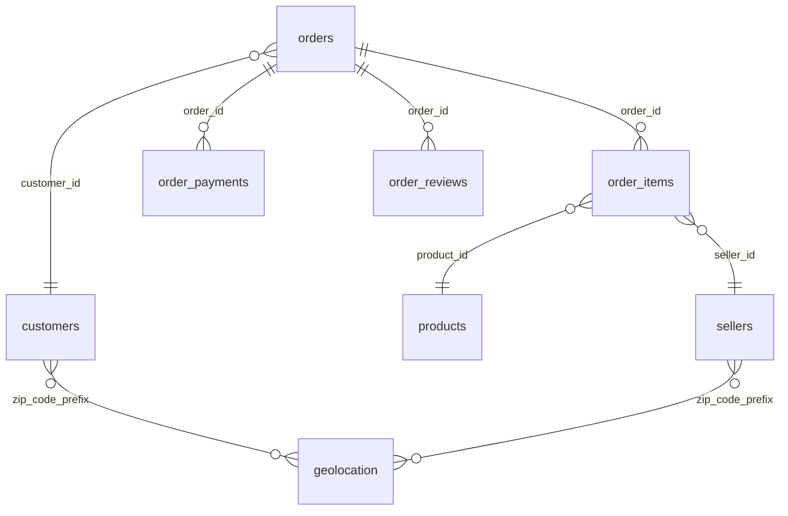

# Olist: Tables and Relationships

## Tables (original dataset names)
- olist_orders_dataset: center of the schema, 1 row per order
- olist_order_items_dataset: items per order, linked to products and sellers
- olist_order_payments_dataset: payments per order
- olist_order_reviews_dataset: reviews per order
- olist_products_dataset: product attributes
- olist_sellers_dataset: seller data
- olist_customers_dataset: customer data (named "olist_order_customer_dataset" in the original diagram)
- olist_geolocation_dataset: zip code prefix to lat/lng coordinates

## Relationships (join keys)
- orders <-> order_payments : order_id
- orders <-> order_reviews  : order_id
- orders <-> order_items    : order_id
- order_items <-> products  : product_id
- order_items <-> sellers   : seller_id
- orders <-> customers      : customer_id
- customers <-> geolocation : zip_code_prefix
- sellers <-> geolocation   : zip_code_prefix

Note: table names in this project's database (schemas raw/staging) may differ from the original dataset names. See docs/olist/profile/ for the actual names and columns.
