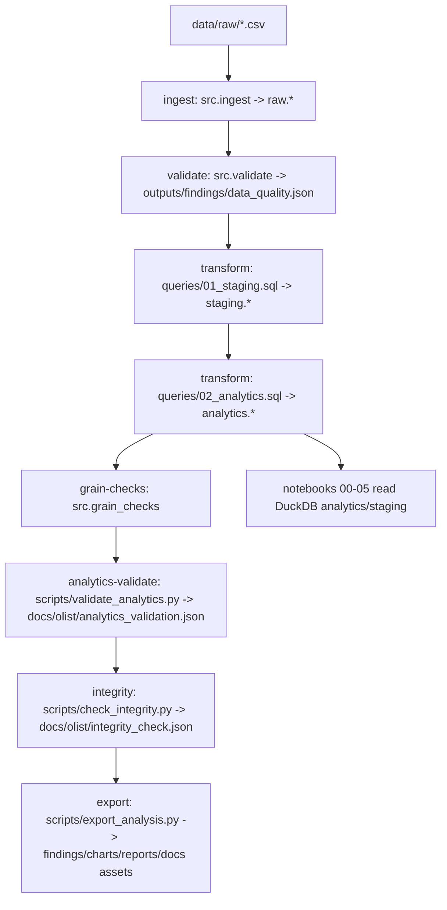

# System Architecture

## Olist Consumer Intelligence & Market Intelligence Assessment

**Project ID:** OLIST-CI-02
**Architecture Version:** 1.2
**Status:** Aligned with current implementation (branch `fix/olist-analytical-integrity`, validated 2026-11-14)

---

## 1. Architecture Overview

This project implements a reproducible, local analytical pipeline over the Brazilian E-Commerce Public Dataset by Olist (Kaggle, observed 2016-09-04 to 2018-10-17). It ingests raw CSVs into DuckDB, builds typed staging and grain-validated analytics tables, runs data quality/analytics/integrity checks, exports findings and charts, and supports notebook/report consumption.

**Principles (implemented):**
1. **Raw immutability:** CSVs in `data/raw/` are read-only inputs; transformations occur in DuckDB schemas via SQL/scripts.
2. **Analytical grain integrity:** every analytics fact/dimension has declared keys in `src/config.py` and is validated (`src/grain_checks.py`, `scripts/validate_analytics.py`).
3. **Reproducibility with explicit rebuild semantics:** pipeline stages are scriptable; full raw rebuild is explicit (`--overwrite`) and can target an isolated `--db-path`.
4. **Governed metrics:** KPI definitions/filters/grains are governed by `docs/olist/03_kpi_definitions.md` v1.1.

---

## 2. Technology Stack

| Layer | Technology | Purpose (actual) |
|-------|-----------|------------------|
| Language | Python 3.11+ | Pipeline, validation, exports, tests |
| Analytical DB | DuckDB (embedded file) | `db/olist.duckdb` with `raw`, `staging`, `analytics` schemas |
| SQL | DuckDB SQL | `queries/01_staging.sql`, `queries/02_analytics.sql` (idempotent CREATE OR REPLACE) |
| Data/analysis | pandas, NumPy, SciPy/statsmodels (deps), matplotlib/plotly/seaborn (deps) | Exports, correlations, charts; notebooks |
| Notebooks | Jupyter (`.ipynb`, nbconvert/nbclient available in env) | Domain analysis `notebooks/00-05` |
| Quality | pytest, ruff, black, mypy | Automated tests, lint, format, type checks |
| Packaging | `pyproject.toml` | Dependencies and project metadata |

---

## 3. Actual Repository Structure (relevant)

```text
.
├─ data/raw/                      # 9 Olist CSVs (gitignored)
├─ db/olist.duckdb                # Default warehouse (gitignored)
├─ queries/
│  ├─ 01_staging.sql              # raw -> staging
│  └─ 02_analytics.sql            # staging -> analytics
├─ src/
│  ├─ __init__.py
│  ├─ config.py                   # Paths, source files, schemas, grain definitions, constants
│  ├─ db.py                       # Connection/schema helpers (get_connection supports db_path, read_only)
│  ├─ ingest.py                   # CSV -> raw tables (explicit overwrite behavior)
│  ├─ validate.py                 # Raw DQ checks; writes outputs/findings/data_quality.json
│  ├─ transform.py                # Runs staging + analytics SQL (transform_all)
│  ├─ grain_checks.py             # Analytics grain assertions
│  └─ pipeline.py                 # CLI orchestration (python -m src.pipeline)
├─ scripts/
│  ├─ profile_olist.py            # Dataset profiling (docs/olist/profile/*)
│  ├─ validate_analytics.py       # Grain + transform reconciliation (--db-path, --out)
│  ├─ check_integrity.py          # Referential integrity (--db-path, --out)
│  └─ export_analysis.py          # Findings/CSVs/charts; optional docs copy (--db-path, --skip-copy-docs, etc.)
├─ notebooks/00-05_*.ipynb        # Executed analysis notebooks (see notebook execution results)
├─ outputs/findings|charts|reports (gitignored by default; regenerable)
├─ docs/                          # Charter, research, KPIs, data dictionary, architecture, DoD, reports/assets, olist/*
├─ tests/
│  ├─ test_pipeline_integrity.py  # DB-backed integrity/KPI checks (skips if artifacts missing)
│  └─ test_unit_synthetic.py      # Synthetic unit tests (no real dataset required)
└─ pyproject.toml, README.md, .gitignore, .github/workflows/ci.yml
```

Note: `src/viz/`, `manifest.json`, and separate per-domain `queries/01_consumer_behavior.sql` files are not part of the current implementation; analysis SQL is consolidated in `queries/02_analytics.sql` and domain exports in `scripts/export_analysis.py`.

---

## 4. Data Flow and Pipeline



### 4.1 Pipeline CLI (`python -m src.pipeline <command>`)

| Command | Actual behavior | `--db-path` | `--overwrite` |
|---|---|---:|---:|
| `ingest` | Loads 9 CSVs from `data/raw/` into `raw.*`. Fails if required files missing. If any raw table exists and overwrite is false, raises error (no implicit destructive rebuild). | Yes | Yes (replaces raw tables) |
| `validate` | Runs raw data quality checks and writes `outputs/findings/data_quality.json` (project findings path). | Yes (connection) | n/a |
| `transform` | Executes `01_staging.sql` then `02_analytics.sql` (CREATE OR REPLACE). | Yes | n/a |
| `grain-checks` | Validates analytics grains/keys per `GRAIN_DEFINITIONS`. | Yes | n/a |
| `analytics-validate` | Runs `scripts/validate_analytics.py` (grain + transform reconciliations). With non-default db-path, pipeline writes to isolated artifact path. | Yes (script) | n/a |
| `integrity` | Runs `scripts/check_integrity.py`. With non-default db-path, pipeline writes to isolated artifact path. | Yes (script) | n/a |
| `export` | Runs `scripts/export_analysis.py` (findings/CSVs/charts; copies curated docs assets unless `--skip-copy-docs`). | Yes (script) | n/a |
| `run` | `ingest -> validate -> transform -> grain-checks -> analytics-validate -> integrity -> export`. When `--db-path` is non-default, validation/export artifacts are written under `db/.<stem>_artifacts/` with `--skip-copy-docs` to avoid overwriting main project outputs. | Yes | Yes (ingest stage) |

**Repeatability (validated on isolated copy, 2026-11-14):** Two sequential `pipeline run --overwrite --db-path db/olist_test_pipeline.duckdb` executions completed successfully with consistent core results (raw_orders 99,441; fact_orders 99,441; gmv_payments ~16,008,872.12; fact_reviews 99,224; grains/validations/integrity PASS). Running against the same DB requires `--overwrite` for the ingest stage because raw tables persist; transform/validate/grain-check stages are idempotent in effect (SQL uses CREATE OR REPLACE).

---

## 5. Analytical Data Model (implemented)

### 5.1 Grain Definitions (`src/config.py`)

| Table | Grain (key) | Notes |
|---|---|---|
| `analytics.fact_orders` | `order_id` | Order-level attributes/values/delivery fields |
| `analytics.fact_order_items` | (`order_id`,`order_item_id`) | Item-level price/freight/product/seller |
| `analytics.dim_customers` | `customer_unique_id` | Aggregated over all linked orders; representative `customer_id` deterministic |
| `analytics.dim_products` | `product_id` | `total_items_sold = COUNT(order_item_id)` |
| `analytics.dim_sellers` | `seller_id` | `total_items_sold = COUNT(order_item_id)` |
| `analytics.fact_payments` | (`order_id`,`payment_sequential`) | Payment rows |
| `analytics.fact_reviews` | (`review_id`,`order_id`) | Preserves duplicate raw `review_id`s linked to different orders; deterministic dedup of exact review-order rows |
| `analytics.fact_delivery` | `order_id` | Delivery timing/buckets/gaps |

### 5.2 Relationships / join guidance
- `fact_orders.order_id` ↔ `fact_order_items|fact_payments|fact_reviews|fact_delivery.order_id`
- `fact_order_items.product_id` ↔ `dim_products.product_id`; `fact_order_items.seller_id` ↔ `dim_sellers.seller_id`
- **Order-level geographic analysis:** join `fact_orders` to `staging.customers` on `customer_id` for `customer_state` (reconciles to 99,441 orders). Do not use `dim_customers` for per-order location because it is keyed by `customer_unique_id` with a representative `customer_id`.
- **Category review metric:** avg order-level review among orders containing the category at distinct `(order_id, category)` (not item-weighted, not causal).

---

## 6. Validation, Quality, and Exports

- **Raw DQ (`src/validate.py`):** row counts, null rates, PK checks (raw reviews PK not unique as observed), referential integrity (NOT EXISTS over non-null FKs), date ranges, review score validity (1–5). Output: `outputs/findings/data_quality.json`.
- **Analytics validation (`scripts/validate_analytics.py`):** grain non-empty/unique/non-null keys + transform reconciliations (payment totals, item counts, review score consistency, customer/product/seller aggregates, delivery consistency, geographic coverage). Output: `docs/olist/analytics_validation.json`.
- **Integrity (`scripts/check_integrity.py`):** raw referential integrity checks. Output: `docs/olist/integrity_check.json`.
- **Exports (`scripts/export_analysis.py`):** regenerates domain findings/CSVs/charts and (by default) copies curated artifacts to `docs/assets`, `docs/executive_summary.md`, `docs/strategic_recommendations.md`. Key metrics follow KPI governance and explicitly document grain/filter/method (Pearson and Spearman computed separately; monthly spine marks boundary months).

---

## 7. DuckDB Concurrency and Locking (observed)

DuckDB file access can be blocked by another process (e.g. open notebook kernel, prior Python process, parallel writers). Observed during remediation: `IO Error: Cannot open file ... used by another process`.

**Safe protocol:** run pipeline/validation/export/notebook execution sequentially; close connections (notebooks include `conn.close()`); avoid parallel writers to the same DB file; ensure no kernels/processes hold the file before overwrite/rebuild. For isolated rebuild tests, use a separate `--db-path` copy.

---

## 8. Security, Data Handling, and Licensing

- Raw data, DuckDB files, and regenerable outputs are gitignored by default (`data/raw/`, `db/`, `outputs/`); no secrets committed.
- Dataset: *Brazilian E-Commerce Public Dataset by Olist* (Kaggle). **Dataset listing license: VERIFIED ON KAGGLE (2026-11-14)** as CC BY-NC-SA 4.0 on https://www.kaggle.com/datasets/olistbr/brazilian-ecommerce (canonical: https://creativecommons.org/licenses/by-nc-sa/4.0/). **Legal interpretation of the intended portfolio/job-application use: NOT INDEPENDENTLY RESOLVED** (context-specific). Project source code license is not declared in-repo (no `LICENSE` file observed/granted). See `docs/dataset_license_notes.md`.
- Data is anonymized by publisher; do not attempt re-identification.

---

## 9. Known Limitations (current)

- `pipeline run` with `--db-path` isolates analytics/integrity/export artifacts (after fix) but `validate` stage writes raw DQ findings to the default project findings path; interpret isolated-run raw DQ artifact accordingly.
- Full `pipeline run --overwrite` on the default `db/olist.duckdb` was **not** executed in this session to avoid destructive rebuild of the working DB; repeatability was demonstrated on an isolated copy.
- Notebooks were executed top-to-bottom in this environment (2026-11-14) with bootstrap/PYTHONPATH handling; nbformat warnings and a benign ZMQ teardown assertion appeared in stderr for some runs but exit codes were 0 and outputs/cells executed.
- Dataset listing license is verified on Kaggle (2026-11-14, CC BY-NC-SA 4.0); legal interpretation for intended use and project source-code license decision remain pending owner authorization (see `docs/dataset_license_notes.md`).
