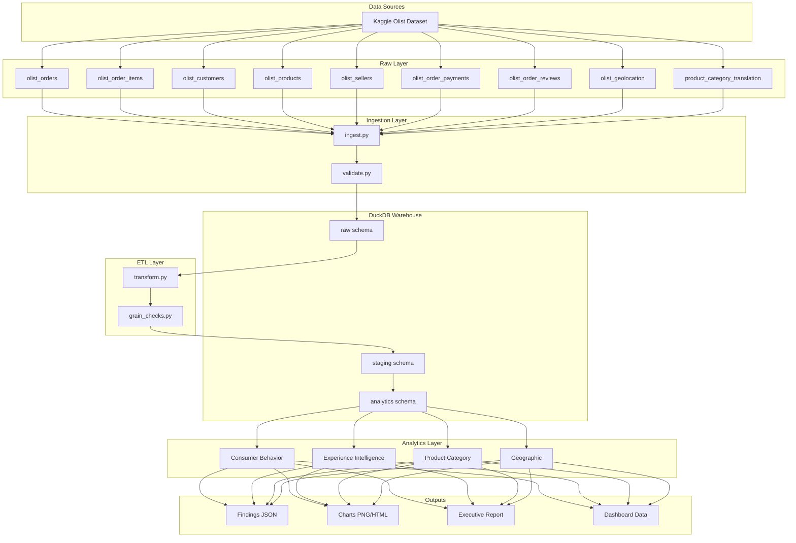
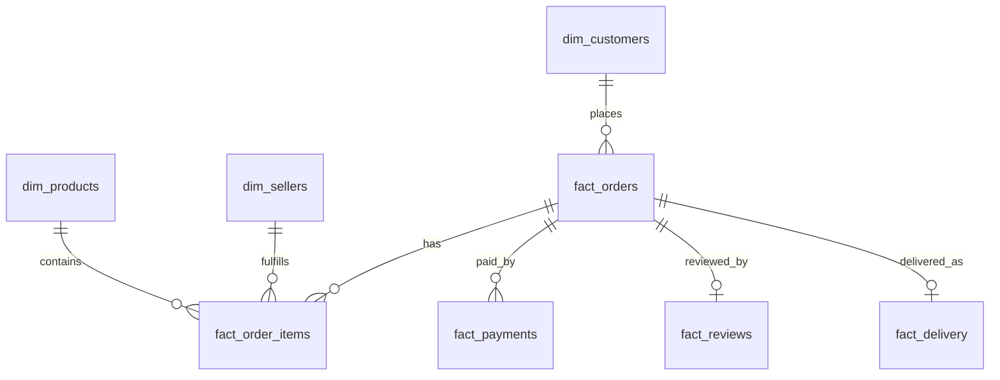

# System Architecture

## Olist Consumer Intelligence & Market Intelligence Assessment

**Project ID:** OLIST-CI-02
**Architecture Version:** 1.0
**Status:** Draft

---

## 1. Architecture Overview

This document defines the end-to-end system architecture for the Olist Consumer Intelligence project. The system ingests raw Olist e-commerce datasets, transforms them into analysis-ready structures, and delivers reproducible analytical outputs across four intelligence domains.

The architecture is designed around three principles:

1. **Reproducibility** — every output can be regenerated from raw data with a single command.
2. **Analytical grain integrity** — each dataset preserves its correct unit of analysis to prevent double counting.
3. **Separation of concerns** — ingestion, transformation, analysis, and reporting are isolated modules.

---

## 2. Technology Stack

| Layer | Technology | Purpose |
|-------|-----------|---------|
| Language | Python 3.11+ | Primary implementation language |
| Analytical DB | DuckDB | Embedded columnar SQL engine for analytical queries |
| Notebook Environment | JupyterLab | Interactive analysis and narrative reporting |
| Data Manipulation | pandas, Polars | DataFrame transformations |
| Visualization | Plotly, Matplotlib, Seaborn | Static and interactive charts |
| Statistical Testing | SciPy, statsmodels | Hypothesis testing and correlation analysis |
| Configuration | PyYAML, python-dotenv | Environment and pipeline configuration |
| Data Validation | pandera | Schema and data quality assertions |
| Packaging | pyproject.toml (uv/pip) | Dependency management |

**Why DuckDB:** DuckDB provides a single-file analytical database that supports full SQL, reads CSV/Parquet directly, and handles datasets of this scale (hundreds of thousands of rows) efficiently without requiring a database server. It is ideal for reproducible, portable analysis.

---

## 3. System Architecture Diagram



---

## 4. Data Flow


### 4.1 Stage Definitions

| Stage | Input | Output | Grain |
|-------|-------|--------|-------|
| Raw | CSV files | `raw.*` tables | Source grain |
| Staging | `raw.*` | `staging.*` tables | Cleaned source grain |
| Analytics | `staging.*` | `analytics.*` tables | Analysis grain |
| Findings | `analytics.*` | JSON + charts | Aggregated |

---

## 5. Analytical Data Model

### 5.1 Grain Definitions

| Table | Grain | Key |
|-------|-------|-----|
| `analytics.fact_orders` | One row per order | `order_id` |
| `analytics.fact_order_items` | One row per order item | `order_id` + `order_item_id` |
| `analytics.dim_customers` | One row per unique customer | `customer_unique_id` |
| `analytics.dim_products` | One row per product | `product_id` |
| `analytics.dim_sellers` | One row per seller | `seller_id` |
| `analytics.fact_payments` | One row per payment record | `order_id` + `payment_sequential` |
| `analytics.fact_reviews` | One row per review | `review_id` |
| `analytics.fact_delivery` | One row per order | `order_id` |

### 5.2 Star Schema Relationships



### 5.3 Key Derived Metrics

| Metric | Definition | Grain |
|--------|-----------|-------|
| `order_value` | Sum of payment_value per order | Order |
| `freight_value` | Sum of freight_value per order | Order |
| `delivery_time_days` | `order_delivered_customer_date` − `order_purchase_timestamp` | Order |
| `estimated_vs_actual_days` | `order_estimated_delivery_date` − `order_delivered_customer_date` | Order |
| `is_repeat_customer` | Whether `customer_unique_id` has >1 order | Customer |
| `review_score` | `review_score` from reviews | Order |

---

## 6. Repository Structure

```text
olist-consumer-intelligence/
├── data/
│   ├── raw/                          # Original Olist CSV files (gitignored)
│   └── processed/                    # Exported Parquet/CSV outputs (gitignored)
├── db/
│   └── olist.duckdb                  # DuckDB database file (gitignored)
├── notebooks/
│   ├── 00_data_quality.ipynb         # Data quality assessment
│   ├── 01_consumer_behavior.ipynb    # RQ1
│   ├── 02_experience_intelligence.ipynb  # RQ2
│   ├── 03_product_category.ipynb     # RQ3
│   ├── 04_geographic_intelligence.ipynb  # RQ4
│   └── 05_synthesis.ipynb            # Cross-domain synthesis
├── src/
│   ├── __init__.py
│   ├── config.py                     # Paths and constants
│   ├── db.py                         # DuckDB connection helpers
│   ├── ingest.py                     # CSV → DuckDB raw
│   ├── validate.py                   # Data quality checks
│   ├── transform.py                  # raw → staging → analytics
│   ├── grain_checks.py               # Grain integrity assertions
│   └── viz/
│       ├── __init__.py
│       └── charts.py                 # Reusable chart functions
├── queries/
│   ├── 01_consumer_behavior.sql
│   ├── 02_experience_intelligence.sql
│   ├── 03_product_category.sql
│   └── 04_geographic.sql
├── outputs/
│   ├── findings/                     # JSON findings per domain
│   ├── charts/                       # Exported charts
│   └── reports/                      # Executive report
├── docs/
│   ├── project_charter.md
│   ├── research_design.md
│   ├── system_architecture.md
│   └── data_dictionary.md
├── tests/
│   └── test_grain_checks.py
├── pyproject.toml
├── .gitignore
└── README.md
```

---

## 7. Component Design

### 7.1 Ingestion Module (`src/ingest.py`)

**Responsibility:** Load raw CSV files into the `raw` schema of DuckDB.

**Functions:**
- `ingest_all()` — iterate over expected CSV files and load each into `raw.<table>`.
- `ingest_one(csv_path, table_name)` — load a single CSV with schema inference.
- `list_source_files()` — verify all 9 expected source files are present.

**Design notes:**
- Uses DuckDB `read_csv_auto` for initial load.
- Stores original column names to preserve traceability.
- Adds `_ingested_at` timestamp for audit.

### 7.2 Validation Module (`src/validate.py`)

**Responsibility:** Assess data quality and referential integrity.

**Checks:**
- Row counts per table.
- Null rates for critical columns.
- Primary key uniqueness.
- Referential integrity (e.g., every `order_id` in items exists in orders).
- Date range sanity (2016–2018).
- Review score range (1–5).

**Output:** `outputs/findings/data_quality.json`

### 7.3 Transformation Module (`src/transform.py`)

**Responsibility:** Build `staging` and `analytics` schemas.

**Steps:**
1. Clean: trim strings, parse dates, normalize categories.
2. Conform: standardize column names and types.
3. Derive: compute `delivery_time_days`, `order_value`, etc.
4. Aggregate: build fact and dimension tables at correct grain.

**Design notes:**
- Each transformation is a pure SQL statement stored in `queries/`.
- Transformations are idempotent — re-running produces identical results.

### 7.4 Grain Checks (`src/grain_checks.py`)

**Responsibility:** Assert that each analytics table has the expected grain.

**Example assertions:**
- `fact_orders` has unique `order_id`.
- `fact_order_items` has unique (`order_id`, `order_item_id`).
- `dim_customers` has unique `customer_unique_id`.
- Sum of item-level `order_value` equals order-level `order_value`.

### 7.5 Visualization Module (`src/viz/charts.py`)

**Responsibility:** Provide reusable, consistent chart functions.

**Functions:**
- `plot_distribution(df, column, title)`
- `plot_correlation(x, y, title)`
- `plot_category_comparison(df, category, metric)`
- `plot_geographic_map(df, region_col, metric)`

**Design notes:**
- All charts saved to `outputs/charts/` as both PNG and HTML.
- Consistent color palette and sizing.

---

## 8. Reproducibility Strategy

| Concern | Approach |
|---------|----------|
| Environment | `pyproject.toml` pins all dependencies |
| Data | Raw CSVs checksummed in `manifest.json` |
| Pipeline | Single entry point: `python -m src.pipeline run` |
| Randomness | Fixed random seeds where sampling is used |
| Outputs | Deterministic file naming with run timestamp |

### 8.1 Pipeline Entry Point

```bash
# Full pipeline
python -m src.pipeline run

# Individual stages
python -m src.pipeline ingest
python -m src.pipeline validate
python -m src.pipeline transform
python -m src.pipeline analyze
python -m src.pipeline report
```

---

## 9. Security and Data Handling

- Raw data files are gitignored and never committed.
- No credentials or secrets are stored in the repository.
- The dataset is publicly available under Olist's Kaggle license; attribution is documented in `docs/data_dictionary.md`.
- No personally identifiable information beyond what is in the public dataset is processed.

---

## 10. Extension Points

| Future need | Extension point |
|-------------|----------------|
| Larger datasets | Swap DuckDB for ClickHouse or BigQuery via `src/db.py` |
| Automated reporting | Add `src/report/` with Jinja2 templates |
| Interactive dashboard | Add Streamlit app reading from `outputs/` |
| Scheduled runs | Add GitHub Actions workflow calling `src.pipeline` |
| Additional data sources | Add new loaders in `src/ingest.py` |

---

## 11. Open Questions

1. Should the final deliverable include an interactive dashboard, or is a static report sufficient?
2. Should geographic analysis use state-level or city-level granularity?
3. Should the executive report be Markdown, PDF, or both?